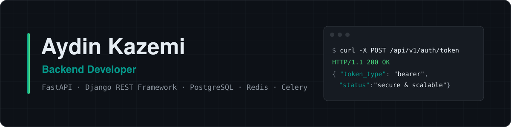

  

Backend developer based in **Mashhad, Iran**. I design and build **secure, scalable RESTful APIs** with **FastAPI** and **Django REST Framework**, and I enjoy the parts that usually get skipped: **authentication flows**, **database design and query optimization**, **background jobs**, and getting services to talk to each other reliably.

## ◆ What I build

Most of my work lives behind the UI: API design, auth, data modeling and the async plumbing that keeps things fast. Lately that means a **doctor–patient platform** built on FastAPI with chat and file exchange, and the backend of an **AI-agent pipeline** that turns PDF documents into code-repository structures. Before that, I spent a year building and maintaining Django/DRF services for e-commerce, healthcare and payment projects, working closely with frontend teams on API integration.

What I focus on:

- RESTful API design with clear contracts and documentation (OpenAPI, Postman)
- Authentication and authorization — JWT, user and role management
- Relational data modeling and query optimization (PostgreSQL, MySQL)
- Background tasks and messaging with Celery, Redis and RabbitMQ
- Search features with Elasticsearch

## ◆ Stack

<table>
  <tr>
    <td><b>Backend</b></td>
    <td></td>
  </tr>
  <tr>
    <td><b>Databases</b></td>
    <td></td>
  </tr>
  <tr>
    <td><b>Cache, queues & search</b></td>
    <td></td>
  </tr>
  <tr>
    <td><b>Tooling</b></td>
    <td></td>
  </tr>
</table>

## ◆ Selected work

Most of these are team projects with private repositories — happy to walk through the architecture on request.

- **Hamyar Salamat** — Doctor–patient platform backend — FastAPI · PostgreSQL · Redis · Celery. Authentication and user management, the consultation request and acceptance flow, chat with file exchange, and patient medical-record management.
- **ZenithAgent** — Backend for an AI-agent pipeline — Django · DRF · PostgreSQL · AG2. A chain of AI agents that extracts information from PDF files and turns it into a code-repository structure. I connect the agents, study how they execute, and own the full lifecycle of files and user accounts.
- **Nyxify** — <!-- TODO: what it is --> — <!-- TODO: Tech · Tech · Tech -->. <!-- TODO: what you built -->

**Earlier work** — **Axinos**, backend for an AR-video-based online store (products, users, orders) · **Nuranus**, patient-information and remote-examination backend with secure APIs · **IPG**, a demo payment gateway for transactions between Iranian and international users. All built with Django · DRF · MySQL.

Also: LLM Agents Hackathon course — Sharif University of Technology AI Scientific Association (2025).

<picture>
  <source media="(prefers-color-scheme: dark)" srcset="https://raw.githubusercontent.com/AydinKazemiMLAB/AydinKazemiMLAB/output/pacman-contribution-graph-dark.svg" />
  <source media="(prefers-color-scheme: light)" srcset="https://raw.githubusercontent.com/AydinKazemiMLAB/AydinKazemiMLAB/output/pacman-contribution-graph.svg" />
  
</picture>

## ◆ Reach me

Open to backend roles and collaboration.

`◆` Clean endpoints, fast queries, quiet servers.